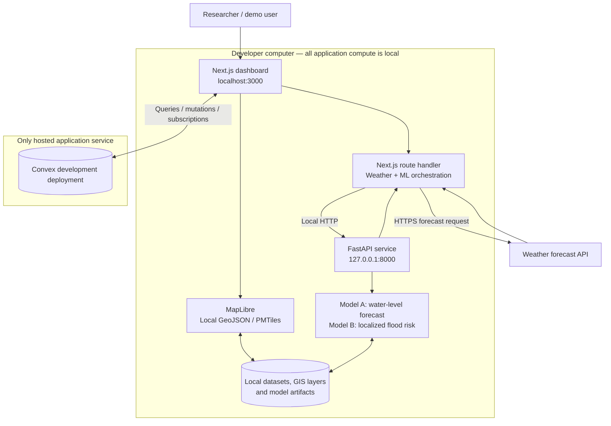

# RiverGuard — Technical Architecture (NCR Local Demonstration Plan)

> **Status:** Proposed architecture for the local research/demo implementation  
> **Study area:** National Capital Region (NCR), Philippines  
> **Initial development-data locations:** Quezon City, Marikina, Manila, and Pasig  
> **Execution model:** Next.js and Python ML service run locally on the developer's computer  
> **Hosted application dependency:** Convex development deployment only  
> **External runtime data integration:** Weather forecast API  
> **Deployment decision:** No public website, ML API, or AWS deployment in the current scope

## 1. Project overview

RiverGuard is a local research prototype for explainable hydrological forecasting and localized flood-risk assessment across NCR. It combines historical rainfall and water-level observations, forecast weather inputs, flood-event records, and geographic information to explore future water-level behavior and flood occurrence risk.

The initial supplied development CSV contains city-level daily records for Quezon City, Marikina, Manila, and Pasig. These four locations are the initial development subset, not complete NCR coverage. Additional NCR locations and finer spatial units must be enabled only when the necessary verified observations, labels, and geographic data are available.

The demonstration has four capabilities:

1. **Hazard/context visualization** — display locally prepared boundaries, relevant hazard layers, waterways, catchments, and available monitoring stations.
2. **Hydrological data management** — inspect time-stamped rainfall, water-level, and environmental observations.
3. **Seven-day forecast workflow** — retrieve weather from an external API, run local ML inference, and save traceable outputs in Convex.
4. **Explainable review** — display risk estimates, model explanations, data quality, uncertainty, and forecast provenance.

Static hazard maps provide susceptibility context. They are not real-time forecasts and are not substitutes for dated flood-event labels or hydrological time series.

## 2. Non-negotiable architecture decisions

### 2.1 The website and ML service run locally; they are never deployed

Next.js runs on the developer's computer using its local development server. FastAPI and model inference also run on the same computer. Do not deploy the website or ML API to Vercel, AWS, or another public hosting provider.

The local computer hosts:

- Next.js frontend and route handlers.
- Python/FastAPI inference service.
- Data import, preprocessing, training, and evaluation.
- Local geographic files and model artifacts.

The demo is not intended to be publicly accessible. Do not expose local ports through router forwarding or a tunneling service.

### 2.2 Convex is the only hosted application backend/database

Continue using Convex for application records and reactive data access. It owns:

- Demo users/roles if required.
- NCR location metadata and supported spatial-unit metadata.
- Monitoring-station metadata.
- Validated observations and data-quality status.
- Weather snapshots and forecast-run metadata.
- Station and spatial prediction records.
- Alert/acknowledgement records if included in the demo.
- Hazard-layer and model-version metadata.

Do not add PostgreSQL, PostGIS, TimescaleDB, RDS, DynamoDB, or a second application database.

Convex is not a host for local model inference. A cloud-hosted Convex function cannot connect to `127.0.0.1` on the developer's computer. Therefore, local Next.js server routes orchestrate the weather request and local FastAPI call. The browser then uses Convex mutations/queries to persist and retrieve application records.

### 2.3 Weather forecast API is the only external runtime data API

A local Next.js server route calls the configured seven-day weather forecast provider. Open-Meteo may be used as the initial provider if its current terms, variables, geographic coverage, and request limits fit the project.

For every requested NCR location, the application must use a documented coordinate or a representative point derived from a verified boundary. Do not invent coordinates. Record:

- Provider name and product/endpoint.
- Request and retrieval timestamps.
- Coordinates and location identifier.
- Timezone and forecast-valid timestamps.
- Units, aggregation rules, and requested variables.
- Provider issue/model metadata when supplied.
- Raw or reproducible normalized input snapshot.

If a provider requires an API key, store it in a server-only local environment variable. Never expose it in `NEXT_PUBLIC_` variables or browser bundles.

No other external runtime APIs are required by the backend workflow. Historical datasets and RiverGuard GIS assets are acquired separately, then stored locally. The current frontend mapping milestone is a deliberate, temporary exception: MapLibre loads the public OpenStreetMap raster basemap with visible attribution so the map workspace can be exercised before verified local layers are supplied. Do not treat this basemap as a RiverGuard boundary, hazard, station, or prediction layer. Before production or an offline demo, replace it with an approved cached/local source and document that provider decision.

### 2.4 Geographic and model assets remain local

Prepare local NCR geographic assets, including only those layers whose sources and licenses are documented:

- NCR boundary and supported city/municipality boundaries.
- Barangay boundaries when verified and available.
- Rivers, creeks, lakes, drainage, and catchment features.
- Elevation/terrain derivatives.
- Flood susceptibility layers with appropriate attribution.

Use local GeoJSON or local PMTiles for RiverGuard-specific layers. Keep raw archives and large source rasters in local gitignored directories. The current frontend baseline may use the explicitly documented OSM basemap exception above, but it must not be used as a substitute for verified RiverGuard GIS assets.

### 2.5 No cloud scheduler or always-on worker

The user manually starts a forecast from the local dashboard. Do not introduce EventBridge, queues, cloud schedulers, or continuously running workers. Convex cron functions are not required for the initial workflow.

### 2.6 No AWS, Vercel, or other deployment infrastructure

Do not provision AWS Lambda, ECR, ECS/Fargate, EC2, API Gateway, S3, CloudFront, IoT Core, SQS, EventBridge, RDS, NAT Gateway, Vercel, a public API host, or a separate storage/CDN service. The previously considered AWS credit is not part of the current execution plan.

## 3. NCR study area and supplied data

### 3.1 Initial supported development locations

The target is NCR. The supplied CSV has city-level daily rows for:

- Quezon City
- Marikina
- Manila
- Pasig

The CSV does not provide records for all NCR LGUs, barangay identifiers, monitoring-station identifiers, coordinates, or river-reach identifiers. The initial demo must not imply broader coverage than the underlying data supports.

Use city-level forecast requests and map summaries for these four locations until verified geographic and hydrological data supports a finer level. Do not expand a city-level label to every barangay in that city.

### 3.2 Supplied CSV audit

The uploaded archive contains `Flood_Prediction_NCR_Philippines.csv` with 7,308 rows and seven columns. It spans 2016-01-01 through 2020-12-31 with 1,827 daily records per each of the four listed locations. It has no missing values and no duplicate `Date` + `Location` pairs in the inspected file. There are 132 positive and 7,176 negative `FloodOccurrence` rows.

Columns are `Date`, `Location`, `Rainfall_mm`, `WaterLevel_m`, `SoilMoisture_pct`, `Elevation_m`, and `FloodOccurrence`.

The archive does not contain a data dictionary, provenance, source organization, station metadata, collection method, or definitions for the rainfall aggregation interval, water-level measurement datum, soil-moisture depth/method, or flood-event label. The city-level elevation field is constant within each location. These values must not be presumed to be official measurements or verified ground truth.

Treat the CSV as a schema/pipeline smoke-test dataset only until provenance and semantics are independently verified. A model trained on it may be used to test code paths, but its performance must not be represented as evidence of real-world NCR flood-prediction capability.

## 4. Recommended technology stack

| Layer | Technology | Responsibility | Execution |
|---|---|---|---|
| Web application | Next.js + TypeScript | Dashboard and route handlers | Local |
| Styling | Tailwind CSS | Layout and responsive UI | Local |
| UI components | shadcn/ui | Reusable components | Local |
| Charts | Recharts | Rainfall, water-level, and risk timelines | Local |
| Interactive maps | MapLibre GL JS | Boundaries, stations, waterways, and risk layers | Local |
| Geographic formats | GeoJSON / local PMTiles | Prepared NCR layers | Local files |
| Application database | Convex | Application records and reactive queries | Convex development deployment |
| ML/API runtime | Python + FastAPI | Feature validation and inference | Local |
| Data processing | Pandas + NumPy | Cleaning and feature engineering | Local |
| Geospatial processing | GeoPandas + Shapely + Rasterio | GIS preprocessing | Local |
| ML baselines | Scikit-learn + XGBoost | Regression and classification | Local |
| Explainability | SHAP | Feature-contribution explanations | Local |
| Weather provider | Open-Meteo or another verified provider | Seven-day forecast input | External API requested by local server |

## 5. High-level architecture



The diagram intentionally has no hosted web server, hosted ML API, AWS compute, object storage, CDN, or remote map tile service.

## 6. Seven-day forecast workflow

```mermaid
sequenceDiagram
    autonumber
    participant U as User
    participant W as Local Next.js UI
    participant R as Local Next.js route
    participant API as Weather API
    participant F as Local FastAPI
    participant A as Model A
    participant B as Model B
    participant C as Convex

    U->>W: Select supported NCR location(s) and request 7-day outlook
    W->>R: POST /api/forecast/run
    R->>API: Request forecast for selected location coordinates
    API-->>R: Forecast + retrieval/validity metadata
    R->>R: Normalize units, timestamps, timezone, and rainfall windows
    R->>R: Join recent observations and local geographic features
    R->>F: POST validated feature payload to 127.0.0.1
    F->>A: Run if suitable gauge data and model exist
    A-->>F: Station water-level output or unavailable status
    F->>B: Run for supported spatial units
    B-->>F: Daily flood-risk output or experimental/unavailable status
    F-->>R: Predictions + explanations + quality metadata
    R-->>W: Structured response
    W->>C: Save forecast run and daily predictions
    C-->>W: Confirmation / reactive query update
    W-->>U: Display map, charts, risk details, and limitations
```



### 6.1 Why local Next.js orchestrates

A Convex cloud function cannot access a FastAPI server bound to the developer's loopback address. The request must be orchestrated by the local Next.js server:

1. Browser asks a local Next.js route to create a forecast.
2. The local route calls the external weather API.
3. The local route prepares the feature payload and calls local FastAPI.
4. The route returns results to the browser.
5. The browser saves the result through Convex mutations.

Do not put Convex credentials or write secrets into the browser. Use authenticated Convex mutations and the project's configured authentication/authorization rules.

## 7. Spatial and forecast behavior

### 7.1 NCR location coverage

The UI may provide a region-wide NCR selector, but the application must show the actual support status for each location. The initial CSV only covers Quezon City, Marikina, Manila, and Pasig. Other NCR areas remain unsupported until data acquisition is completed.

For weather forecast calls, use representative coordinates from verified administrative polygons or documented monitoring stations. Weather data at a city representative point is regional context, not street-level rainfall measurement. Do not imply that one forecast coordinate resolves barangay-to-barangay differences.

### 7.2 Spatial units

- Use monitoring stations for Model A.
- Use subcatchments or grid cells for Model B where hydrological and event data support them.
- Aggregate spatial predictions to barangay or city summaries only using a documented method.
- If the only verified data is city-level, make city-level outputs only.
- Display “No prediction” for unsupported areas; never default them to low risk.

### 7.3 Seven-day horizons

- Preserve hourly weather values when needed by model features.
- Generate daily summaries only with explicit aggregation rules.
- Days 1–3 should be described according to demonstrated lead-time performance.
- Days 4–7 should be marked as extended outlook unless held-out validation supports stronger claims.
- Record forecast retrieval time, validity timestamps, source, coordinates, and model version for every run.

## 8. Local API contracts

### 8.1 Next.js route

Suggested route:

```text
POST /api/forecast/run
```

Responsibilities:

1. Validate supported location IDs and forecast horizon.
2. Resolve stored/verified coordinates for each supported location.
3. Retrieve weather data from the configured provider.
4. Normalize timestamps, timezone, units, and accumulation windows.
5. Combine available recent observations and local geographic features.
6. Call local FastAPI.
7. Return predictions and provenance/quality metadata.

Illustrative request:

```json
{
  "location_ids": ["quezon-city", "marikina", "manila", "pasig"],
  "forecast_horizon_days": 7,
  "timezone": "Asia/Manila"
}
```

Illustrative response:

```json
{
  "run_id": "local-run-identifier",
  "study_area": "NCR",
  "supported_locations": ["quezon-city", "marikina", "manila", "pasig"],
  "model_status": {
    "hydrological": "unavailable_or_ready",
    "flood_risk": "experimental_or_ready"
  },
  "forecast_metadata": {
    "provider": "configured-weather-provider",
    "retrieved_at": "2026-11-06T08:00:00+08:00",
    "timezone": "Asia/Manila",
    "horizon_days": 7
  },
  "daily_predictions": [],
  "data_quality_warnings": [],
  "model_versions": {}
}
```

Examples are schema illustrations, not current weather results or real model outputs.

### 8.2 Local FastAPI endpoints

| Method | Endpoint | Purpose |
|---|---|---|
| GET | `/health` | Confirm local ML service availability |
| GET | `/api/v1/models` | Report loaded model names and versions |
| POST | `/api/v1/predict/water-level` | Run Model A for supported stations |
| POST | `/api/v1/predict/flood-risk` | Run Model B for supported spatial units |
| POST | `/api/v1/predict/combined` | Run both supported paths for one forecast request |

Request and response schemas must be versioned and tested. FastAPI running does not mean that every model is trained or available.

## 9. Convex data ownership

Convex is the source of truth for application records in the demo. It is not a raw scientific data lake and does not host local inference.

Suggested tables:

| Table | Purpose | Example fields |
|---|---|---|
| `users` | Demo users and roles | name, email, role |
| `locations` | NCR city/municipality and spatial-unit registry | locationCode, name, type, parentId, coordinates, coverageStatus |
| `monitoring_stations` | Station registry | stationCode, name, coordinates, riverName, status, units |
| `sensor_readings` | Time-stamped observations | stationId, timestamp, waterLevel, rainfall, source, qualityStatus |
| `weather_snapshots` | Retrieved weather inputs | runId, provider, retrievedAt, locationId, validAt, variables |
| `forecast_runs` | Execution/provenance record | locationIds, generatedAt, horizonDays, weatherSnapshotIds, status |
| `station_forecasts` | Model A outputs | runId, stationId, targetTimestamp, predictedWaterLevel, modelVersion |
| `spatial_forecasts` | Model B outputs | runId, spatialUnitId, validDate, probability, riskCategory, modelVersion |
| `risk_thresholds` | Documented thresholds | location/station, threshold, unit, source, effectiveFrom |
| `alerts` | Demo alert lifecycle | locationId, severity, status, message, createdAt, acknowledgedAt |
| `hazard_layers` | Local map-layer metadata | name, hazardType, source, attribution, localAssetPath, enabled |
| `model_versions` | Model registry metadata | modelName, version, trainedAt, metrics, featureSchemaVersion |

Suggested indexes:

- `sensor_readings`: station ID + timestamp.
- `weather_snapshots`: location ID + retrieved timestamp.
- `forecast_runs`: generated timestamp.
- `station_forecasts`: run ID + station ID + target timestamp.
- `spatial_forecasts`: run ID + spatial unit ID + valid date.

Use bounded and paginated historical queries. Keep raw raster files, satellite scenes, and large model artifacts on the local filesystem.

## 10. Local datasets, GIS, and model storage

Keep the following local:

- Raw CSV/XLSX and downloaded source datasets.
- Processed training tables and feature matrices.
- NCR administrative boundaries and spatial-unit layers.
- River, creek, drainage, catchment, land-cover, soil, DEM/DTM, and derived terrain layers.
- Model artifacts, preprocessing pipelines, model cards, and evaluation reports.

Suggested layout:

```text
riverguard/
├── apps/web/
│   ├── app/api/forecast/run/route.ts
│   └── public/maps/
├── convex/
├── services/ml/
│   ├── app/
│   │   ├── api/
│   │   ├── core/
│   │   ├── schemas/
│   │   └── services/
│   ├── models/
│   │   ├── hydrological/
│   │   └── flood_risk/
│   ├── tests/
│   └── pyproject.toml
├── data/
│   ├── samples/
│   ├── raw/                 # gitignored
│   ├── processed/           # gitignored
│   ├── geographic/          # gitignored when large/private
│   └── external/            # optional local copies with provenance
└── docs/
```

Keep small, non-sensitive fixtures and schemas in Git. Do not commit large raw data, private sensor records, or trained model binaries without an explicit repository decision.

## 11. Supplied NCR dataset: limitations and intended use

The supplied `Flood_Prediction_NCR_Philippines.csv` has 7,308 rows and seven fields for Quezon City, Marikina, Manila, and Pasig, daily from 2016-01-01 through 2020-12-31. It contains one record per date and location, no missing values in the inspected file, no duplicate date/location pairs, and 132 positive `FloodOccurrence` values.

Fields:

- `Date`
- `Location`
- `Rainfall_mm`
- `WaterLevel_m`
- `SoilMoisture_pct`
- `Elevation_m`
- `FloodOccurrence`

The archive does not document source, collection method, station/site identity, coordinates, rainfall aggregation period, water-level datum, soil-moisture depth, elevation reference, or flood-label definition. The `Elevation_m` value is constant within each city in the file. Therefore:

- Treat this as a provisional schema/pipeline test dataset until provenance is verified.
- Do not present its rows as official observed data or confirmed flood records.
- Do not assume it represents all NCR LGUs or any barangay-level condition.
- Do not report model performance on it as real-world predictive performance.
- Preserve it unchanged and record its archive checksum/source notes.

The dataset's date-level frequency also means it cannot train hourly prediction targets without additional higher-frequency observations.

## 12. Security and failure handling

### Local network boundaries

- Bind FastAPI to `127.0.0.1`, not `0.0.0.0`, during the local demo.
- Do not expose local ports through router forwarding or tunnels.
- Keep weather API keys and other secrets in server-only local environment variables.
- Keep Convex credentials and local environment files out of Git.
- Protect Convex mutations with the project's authentication and authorization rules.
- Do not embed secret credentials in browser bundles.

### Failure behavior

| Failure | Required behavior |
|---|---|
| Weather API unavailable | Show retrieval failure; do not silently present stale data as current |
| Weather forecast stale | Display retrieval and validity timestamps |
| Local ML service offline | Keep weather display available; mark ML predictions unavailable |
| Model A missing/inadequate | Do not display station-level water-level prediction |
| Model B untrained/unvalidated | Display static context only or clearly labeled experimental output |
| Required feature missing | Return data-quality warning; do not zero-fill |
| Convex unavailable | Keep the run locally visible where feasible, mark it unsaved, and allow controlled retry |
| Unsupported NCR location | Show “No prediction” rather than low risk |
| Model/schema mismatch | Reject inference with a clear compatibility error |

## 13. Explainability, evaluation, and public-safety safeguards

- SHAP values describe model contribution, not physical causation.
- Evaluate water-level regression with MAE, RMSE, and bias by location and lead time.
- Evaluate flood classification with precision, recall, F1, PR-AUC, confusion matrices, and probability calibration.
- Use chronological and event-based holdouts to prevent leakage.
- Assess false alarms, missed events, and lead time.
- Show model version, feature-schema version, weather source, retrieval time, and input window for each prediction.
- Distinguish static susceptibility, model-generated flood risk, and official warnings.
- Never imply an experimental result is an official PAGASA or LGU warning.
- Do not automatically issue evacuation orders.

## 14. Local operational model

No AWS or public hosting budget is required by the current scope. The expected remote dependencies are:

1. Convex development deployment for application persistence and reactive data access.
2. The selected weather forecast API for user-requested forecasts.

All frontend hosting, backend compute, ML inference, model training, and GIS preprocessing happen locally. The local machine needs sufficient memory, CPU, and disk for the selected models and datasets. RiverGuard-specific map layers must use local files; the frontend currently uses the documented OSM basemap exception until an approved local/cached basemap is supplied.

## 15. Local startup checklist

1. Start Convex with the project's configured `npx convex dev` command.
2. Start FastAPI on `127.0.0.1:8000`.
3. Start Next.js on `localhost:3000`.
4. Verify Convex connection and FastAPI `/health`.
5. Verify the weather API can return seven-day data for the selected NCR locations using documented coordinates.
6. Verify the local route passes the normalized feature payload to local FastAPI.
7. Verify results are saved to Convex and can be reloaded.
8. Verify unavailable locations, missing data, stale forecasts, and model uncertainty are presented accurately.

## 16. References

- [Convex documentation](https://docs.convex.dev/)
- [Next.js documentation](https://nextjs.org/docs)
- [FastAPI documentation](https://fastapi.tiangolo.com/)
- [Open-Meteo Forecast API documentation](https://open-meteo.com/en/docs)
- [MapLibre GL JS documentation](https://maplibre.org/maplibre-gl-js/docs/)
- [PMTiles documentation](https://docs.protomaps.com/pmtiles/)
- [GeoPandas documentation](https://geopandas.org/en/stable/)
- [XGBoost documentation](https://xgboost.readthedocs.io/)
- [Scikit-learn documentation](https://scikit-learn.org/stable/)
- [SHAP documentation](https://shap.readthedocs.io/)
