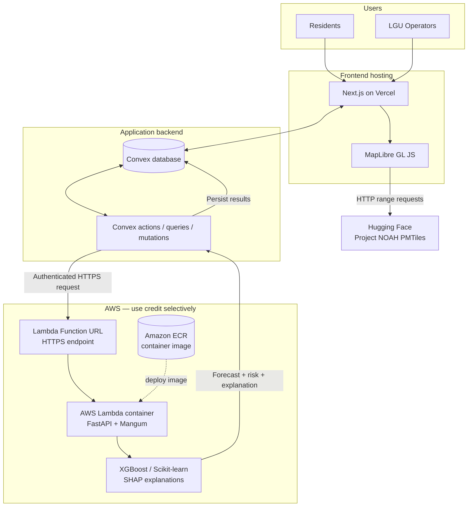
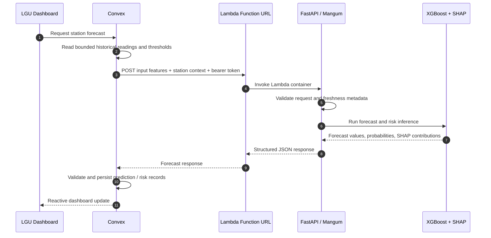
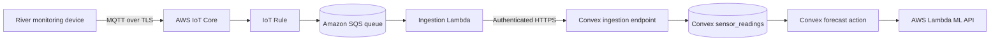
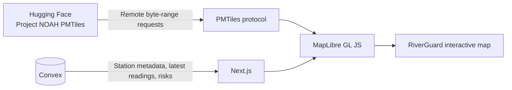

# RiverGuard — Technical Architecture (Minimal AWS Plan)

> **Status:** Proposed architecture for the initial implementation  
> **Architecture principle:** Use the existing Convex-first application design and spend AWS credits only on capabilities that benefit from AWS. Avoid always-on infrastructure until measured demand justifies it.  
> **AWS budget constraint:** Approximately **US$130 in AWS credits** is available. The credit balance, expiry date, and eligible services must be verified in the AWS Billing console before deployment.

## 1. Project overview

RiverGuard is a web-based, explainable hydrological monitoring and flood-risk forecasting system. It is intended to help local government units (LGUs) and residents understand changing river conditions through near-future water-level forecasts, localized flood-risk estimates, interactive hazard maps, and timely warnings.

The initial system is designed around four capabilities:

1. **Hazard-map visualization** — display Project NOAH hazard layers alongside monitoring stations and current risk information.
2. **Hydrological data management** — collect, validate, and store time-stamped rainfall and water-level observations.
3. **Forecasting and risk assessment** — use historical and current observations to forecast water levels and estimate the probability of exceeding locally defined thresholds.
4. **Explainable warnings** — show the factors that contributed to a model result and provide LGU operators with tools to review and publish alerts.

Project NOAH hazard maps provide static or baseline hazard context. They are not live flood forecasts and are not, by themselves, time-series data suitable for training a water-level forecasting model. Forecasting requires timestamped hydrological observations and suitable historical records.

## 2. Architecture decisions

### 2.1 Keep Convex as the primary application database

RiverGuard will continue to use **Convex** for application data and real-time application updates. Do not add PostgreSQL, PostGIS, TimescaleDB, or Amazon RDS to the initial deployment.

Convex owns:

- Users, roles, and LGU profiles.
- Monitoring-station metadata.
- Sensor observations and their quality/status metadata.
- Forecast results and risk assessments.
- Alerts and alert acknowledgements.
- Hazard-layer metadata and references to externally hosted map files.
- Model-version metadata and evaluation summaries.

Use indexes for real application access patterns and paginate historical readings. Do not load unbounded station histories into a single query.

### 2.2 Use AWS Lambda for the initial Python/FastAPI deployment

The initial AWS workload will be **AWS Lambda running a container image that contains the FastAPI application**. Use the Mangum ASGI adapter to expose FastAPI through Lambda's event handler interface.

Before committing to AWS Lambda, evaluate simplified PaaS hosting (for example Render or Railway) first to save time and reduce infrastructure operational overhead; proceed with AWS Lambda/Mangum only if a PaaS option does not meet the project's needs. This matches Phase 4 of the delivery plan.

Why Lambda instead of ECS/Fargate for the current budget:

- There is no continuously running container to pay for while idle.
- The ML API can scale with requests.
- Lambda can expose an HTTPS Function URL without a separate API Gateway for this simple server-to-server API.
- The initial forecasting workload is request/response inference, not a long-running server process.

The container image will be stored in **Amazon Elastic Container Registry (ECR)**. AWS Lambda supports container images stored in ECR, with a maximum uncompressed image size of 10 GB. Keep the image as small as practical because image storage is separately billed under ECR pricing.

**Important workload boundary:** Lambda is for model inference and short preprocessing tasks. Do model training, large backfills, and long-running experiments locally or in a separate development environment. Lambda has a maximum execution timeout of 15 minutes, and synchronous request/response payloads have size limits. If inference becomes consistently long-running or needs persistent workers, reassess ECS/Fargate or another managed container host.

### 2.3 Use a Lambda Function URL instead of API Gateway initially

Expose the inference function through an AWS Lambda Function URL. The Function URL has no separate endpoint fee; normal Lambda invocation and compute charges still apply.

For the initial Convex-to-Lambda integration:

- Configure the Function URL with `AuthType: NONE`.
- Require a high-entropy bearer token in the FastAPI request handler.
- Store the token only in Convex server-side environment variables and Lambda environment variables.
- Never call the ML Function URL directly from browser code or expose the token to Next.js client components.
- Keep CORS disabled because this is a server-to-server endpoint.
- Set a low Lambda reserved-concurrency limit during development to limit unexpected parallel execution and protect the credit balance.

This is application-level authentication: Lambda accepts the HTTP request before FastAPI checks the token, so an exposed URL can still receive unauthenticated invocation attempts. Do not treat the URL as private. For a stronger AWS-native option, change to `AuthType: AWS_IAM` and have the calling service sign requests with AWS Signature Version 4 (SigV4). That is more secure but requires implementing and testing request signing in the Convex server action.

### 2.4 Keep Project NOAH hosted remotely during the initial implementation

Do not copy the multi-gigabyte PMTiles archives into the repository or AWS at the start. Continue loading the selected Project NOAH PMTiles archive directly from its Hugging Face source through MapLibre and the PMTiles protocol.

This avoids using AWS credits for a dataset that is already hosted. The initial architecture does not use a separate object-storage service. If a future production requirement makes remote Hugging Face delivery unsuitable, storage can be reassessed separately. If the data is mirrored or adapted, preserve the source dataset's applicable ODbL attribution and share-alike obligations.

### 2.5 Keep scheduled orchestration in Convex initially

Use Convex scheduled functions/actions for application-level scheduled workflows, such as requesting a forecast for monitored stations. Do not introduce EventBridge solely to duplicate a schedule that Convex already owns.

## 3. Recommended technology stack

| Layer | Technology | Responsibility |
|---|---|---|
| Web application | Next.js | Public interface and LGU dashboard |
| Language | TypeScript | Frontend and Convex application code |
| UI styling | Tailwind CSS | Layout and styling |
| UI components | shadcn/ui | Reusable dashboard components |
| Charts | Recharts | Rainfall, water-level, and forecast charts |
| Interactive maps | MapLibre GL JS | Hazard layers, stations, rivers, and risk overlays |
| Map archive format | PMTiles | Cloud-optimized vector-tile access |
| Initial hazard-map source | Hugging Face Project NOAH dataset | Remotely hosted baseline hazard layers |
| Application database | Convex | Application records, observations, predictions, alerts, and live updates |
| ML/API runtime | Python + FastAPI + Mangum | HTTP API and Lambda-compatible ASGI adapter |
| ML compute | AWS Lambda | On-demand inference and short preprocessing |
| Container registry | Amazon ECR | Versioned Lambda container images |
| ML/data processing | Pandas + NumPy | Data cleaning and feature engineering |
| Initial ML models | Scikit-learn + XGBoost | Regression and classification baselines |
| Explainability | SHAP | Feature-contribution explanations |
| Frontend hosting | Vercel | Next.js deployment |
| Object storage | None initially | Keep Project NOAH PMTiles on Hugging Face and package the initial model artifact in the Lambda image. |
| Future sensor ingress | AWS IoT Core + SQS + Lambda (optional) | Secure device messaging and buffered ingestion |

## 4. System architecture

### 4.1 High-level architecture — initial implementation



### 4.2 Forecast request and response workflow



### 4.3 Future physical-sensor workflow — not part of the first deployment



Only add IoT Core and SQS when physical devices are available and their communication protocol, message rate, and device identity requirements are known. A simulator or manually imported sample dataset does not need this infrastructure.

### 4.4 Project NOAH map delivery



## 5. AWS service scope and exclusions

### 5.1 AWS services to enable initially

| AWS service | Initial use | Cost-control approach |
|---|---|---|
| AWS Lambda | Run the FastAPI ML inference container on demand | No provisioned concurrency; low reserved concurrency; short timeout appropriate to inference |
| Amazon ECR | Store the Lambda container image | Keep the image small; configure an image lifecycle policy to remove old untagged images |
| AWS Budgets | Alert on AWS account/project spend | Create a low monthly cost budget and forecast alerts |
| IAM | Lambda execution role and deployment permissions | Least-privilege policies; do not use root credentials for deployment |

### 5.2 AWS services explicitly deferred

| Service | Decision | Reason to defer |
|---|---|---|
| ECS / Fargate | Do not use initially | An always-running API container is unnecessary for low-volume inference and can consume credits while idle. Reconsider if persistent workers, low-latency warm capacity, or long-running requests become necessary. |
| API Gateway | Do not use initially | A Lambda Function URL is sufficient for the private server-to-server inference endpoint. Add API Gateway only if advanced throttling, API keys, stage management, or gateway features are required. |
| Separate object storage or CDN | Do not use initially | Project NOAH is already hosted on Hugging Face, and the initial model artifact can be packaged with the Lambda image. Avoid adding storage and CDN configuration before a production need exists. |
| AWS IoT Core | Future phase | There are no confirmed physical sensors in the initial application. |
| Amazon SQS | Future phase | Add a durable queue when device ingestion or burst buffering requires it. |
| EventBridge | Defer | Convex scheduled functions can orchestrate the first scheduled forecasts. |
| RDS / Aurora / DynamoDB | Do not add | Convex remains the authoritative application database. |
| NAT Gateway | Avoid | The Lambda function does not need private VPC connectivity for this design. A VPC-connected Lambda that needs public internet access can require NAT infrastructure and add cost. |
| Load Balancer | Avoid | Lambda Function URL does not require an application load balancer. |
| EKS / Kubernetes | Avoid | Unnecessary operational overhead for this project stage. |

## 6. Convex and AWS integration boundary

Convex remains the source of truth for application data. AWS Lambda is a stateless compute service that receives a bounded inference payload and returns a result. Do not make Lambda a second application database.

Recommended flow:

1. The frontend calls a Convex action to request a forecast.
2. The Convex action reads the station configuration, locally established thresholds, and a bounded window of recent readings.
3. The Convex action constructs a validated feature payload and calls the Lambda Function URL over HTTPS.
4. FastAPI validates the bearer token and request schema, then executes inference.
5. Lambda returns forecast values, risk probabilities, SHAP contributions, model version, input window, and data-quality metadata.
6. The Convex action validates the response and calls an internal mutation to save prediction and risk-assessment records.
7. Convex subscriptions update the dashboard.

This boundary avoids giving the ML container broad Convex database credentials. The ML service should not independently read or write arbitrary application records.

Example request shape (illustrative; finalize with the shared schema before implementation):

```json
{
  "station_id": "station-001",
  "generated_at": "2026-10-30T08:00:00+08:00",
  "input_window": {
    "start": "2026-10-30T02:00:00+08:00",
    "end": "2026-10-30T08:00:00+08:00"
  },
  "measurements": [],
  "thresholds": [],
  "feature_schema_version": "v1"
}
```

The payload is an interface example, not a claim that these measurements or thresholds already exist.

## 7. FastAPI implementation for Lambda

### 7.1 Application entry point

Keep the FastAPI application usable locally with Uvicorn and expose a Mangum handler for Lambda. The final implementation should follow this pattern:

```python
from fastapi import FastAPI
from mangum import Mangum

app = FastAPI(title="RiverGuard ML API")

@app.get("/health")
def health():
    return {"status": "ok"}

# AWS Lambda handler. Local development still uses Uvicorn.
handler = Mangum(app)
```

Local development command:

```bash
uvicorn app.main:app --host 127.0.0.1 --port 8000 --reload
```

Lambda handler setting:

```text
app.main.handler
```

### 7.2 Container deployment

Add a Lambda-compatible Dockerfile under `services/ml/Dockerfile`. Use an official AWS Lambda Python base image and install only production inference dependencies. Do not include notebooks, training-only packages, development tools, or raw training datasets in the deployment image.

A Lambda container image is not launched with the normal Uvicorn command. The AWS Lambda base image uses the handler configured as the image command. Keep local Uvicorn execution as a separate development path.

### 7.3 Model packaging

For the initial model:

- Train and evaluate outside Lambda.
- Export a versioned model artifact.
- Include a small inference artifact in the versioned Lambda image.
- Record model version and feature-schema version with every prediction.
- Rebuild and redeploy the image when promoting a new model.

If model artifacts become too large for the Lambda image or need independent updates, reassess the deployment design before adding object storage. For the initial implementation, keep the model artifact versioned and packaged with the Lambda image.

## 8. Data ownership and storage boundaries

| Data category | Initial storage | Notes |
|---|---|---|
| Users and roles | Convex | Role-based authorization for privileged operations. |
| LGU profiles | Convex | Associate users, stations, and alert permissions with an LGU. |
| Monitoring stations | Convex | Station ID, name, coordinates, river/basin association, units, and operational status. |
| Sensor readings | Convex | Timestamped observations with source and quality metadata. Use indexed, bounded queries. |
| Forecasts | Convex | Forecast horizon, predicted level, generation time, model version, and input-data window. |
| Risk assessments | Convex | Threshold, estimated exceedance probability, category, and explanation metadata. |
| Alerts | Convex | Status, severity, affected area/stations, timestamps, issuer, and acknowledgement history. |
| Hazard-layer metadata | Convex | Layer name, description, attribution, source, and PMTiles URL. |
| Project NOAH PMTiles | Hugging Face initially | Access remotely; do not commit map archives to Git. |
| ML container image | Amazon ECR | Versioned image used by Lambda. |
| Initial model artifact | Included in Lambda image | No separate object-storage bucket is required initially. |
| Historical archive / bulk datasets | Not selected yet | Define a retention and archival policy before introducing another storage service. |

### 8.1 Suggested Convex tables

| Table | Example fields | Purpose |
|---|---|---|
| `users` | `name`, `email`, `role`, `lguId` | User identity and authorization metadata |
| `lgu_profiles` | `name`, `region`, `province`, `municipality` | LGU organization information |
| `monitoring_stations` | `stationCode`, `name`, `latitude`, `longitude`, `riverName`, `status`, `waterLevelUnit` | Station registry and location metadata |
| `sensor_readings` | `stationId`, `timestamp`, `waterLevel`, `rainfall`, `soilMoisture`, `source`, `qualityStatus` | Time-stamped observations |
| `predictions` | `stationId`, `generatedAt`, `horizonMinutes`, `targetTimestamp`, `predictedWaterLevel`, `modelVersion`, `inputWindow` | Forecast results |
| `risk_assessments` | `stationId`, `generatedAt`, `thresholdId`, `exceedanceProbability`, `riskCategory`, `modelVersion`, `explanation` | Flood-threshold risk estimates |
| `risk_thresholds` | `stationId` or `locationId`, `name`, `waterLevel`, `unit`, `source`, `effectiveFrom` | Locally established thresholds and provenance |
| `alerts` | `stationId`, `locationId`, `severity`, `status`, `message`, `createdAt`, `issuedBy` | Warning lifecycle and operator actions |
| `hazard_layers` | `name`, `hazardType`, `source`, `attribution`, `tileUrl`, `format`, `enabled` | External hazard-layer metadata |
| `model_versions` | `modelName`, `version`, `artifactUrl`, `trainedAt`, `metrics`, `featureSchemaVersion` | Model metadata and evaluation results |

### 8.2 Index and query patterns

For `sensor_readings`, the primary historical access pattern is retrieving a bounded time range for one station. Define a compound index equivalent to:

```typescript
.index("by_station_timestamp", ["stationId", "timestamp"])
```

Also:

- Always bound historical queries by station and time range where possible.
- Paginate older readings and historical records.
- Avoid fetching an entire station history for each dashboard render.
- Preserve units, source timestamps, ingestion timestamps, and quality flags.
- Define a retention and export policy before sensor volume grows significantly.

## 9. Machine-learning design

### 9.1 Start with a measurable baseline

Begin with supervised-learning models for structured hydrological observations. Do not begin with deep learning unless dataset size, sampling frequency, and validation results justify it.

- **Water-level forecasting:** XGBoost regression as a baseline, compared with persistence and simple statistical baselines.
- **Flood-threshold classification:** Scikit-learn or XGBoost to estimate the probability of exceeding a locally defined water-level threshold within a stated forecast horizon.
- **Explainability:** SHAP feature contributions for supported model types.

### 9.2 Candidate input features

Select features based on actual availability and quality:

- Current and lagged water-level measurements.
- Water-level change over recent intervals.
- Rolling rainfall totals (for example, 1-hour, 3-hour, 6-hour, and 24-hour windows).
- Recent and forecast rainfall, when a reliable forecast source exists.
- Soil-moisture observations, when measured and reliable.
- Station, river, and catchment characteristics.
- Elevation, slope, and other terrain-derived attributes.
- Upstream station observations, where hydrological connectivity and travel time are established.

Do not treat unavailable inputs as measured values. Track missingness and input quality, and define safe behavior when required inputs are stale or absent.

### 9.3 Forecast and risk outputs

Every output should identify:

- Station and location.
- Forecast generation timestamp and target timestamp/horizon.
- Predicted water level and unit, where applicable.
- Threshold and threshold source, where applicable.
- Estimated exceedance probability and risk category, where applicable.
- Model name/version and feature-schema version.
- Input-data time window and freshness.
- Missing-input or data-quality warnings.
- Explanation method and feature contributions, when available.

Validate and calibrate probabilities against held-out historical events. A probability is not certainty and must not be presented as such.

### 9.4 Explainability and evaluation

SHAP describes how input features contributed to a particular model output; it does not prove physical causation. Present these values as model explanations, not causal conclusions.

Use time-aware, storm-event-based validation. Do not randomly split adjacent observations from the same storm event across training and test sets.

| Task | Evaluation |
|---|---|
| Water-level regression | MAE, RMSE, error by forecast horizon and station |
| Threshold classification | Precision, recall, F1, precision-recall AUC, confusion matrix |
| Probability estimates | Calibration curve and an appropriate probability scoring metric |
| Operational warning performance | Lead time, missed events, false alarms, and data availability |

## 10. Security, reliability, and public-safety safeguards

- Keep the Lambda Function URL, shared token, Convex credentials, and deployment credentials out of browser code and Git.
- Authenticate all ML inference requests. Never rely on the Function URL being secret.
- Use a dedicated least-privilege Lambda execution role. Do not grant broad administrator permissions to the runtime.
- Do not attach the initial Lambda function to a customer VPC. It only needs HTTPS access to Convex; Lambda has internet connectivity by default outside a customer VPC. Attaching it to a VPC can require additional networking to retain internet access.
- Set a small reserved-concurrency limit during the prototype and increase it only after load testing.
- Set Lambda timeout and memory based on measured inference time and peak memory use.
- Use local structured logs during development; never log raw sensor payloads, credentials, or bearer tokens. Keep production error responses generic.
- Validate station identifiers, timestamps, measurement units, and plausible value ranges.
- Preserve source timestamp and ingestion timestamp to identify delayed/out-of-order observations.
- Track sensor health, data freshness, missing values, and quality status.
- Record model version and input-data provenance with every prediction.
- Record alert creation, publication, acknowledgement, and resolution actions.
- Treat ML output as decision support. Do not equate a model classification with an official evacuation order.
- Ensure warning thresholds, escalation rules, and public messaging are reviewed by responsible authorities.

## 11. AWS credit and cost-control plan

### 11.1 Treat the US$130 credit as a finite project budget

Before creating services, open **Billing and Cost Management → Credits** and verify:

- Remaining credit balance.
- Expiration date.
- Eligible services and products.
- Whether the credit is promotional, educational, or attached to a specific AWS program.

AWS promotional credits apply only to eligible charges and stop applying when exhausted or expired. Do not assume every AWS service, Marketplace item, tax, or account charge is covered by the credit. Review the terms attached to the actual credit in the account.

### 11.2 Configure cost monitoring before deploying

Create an AWS Budget for the project. A suggested initial warning budget is **US$10 per month**, with notifications at 50%, 80%, and 100%, plus a forecasted-cost notification. Adjust the threshold if the project has a known deadline or planned experiment.

A budget alert is a notification, **not a hard spending cap**. AWS Budgets data can also be delayed, so check the Billing console regularly and delete unused resources.

### 11.3 Keep the first AWS footprint small

The initial deployment should use only:

1. One Lambda function (FastAPI + inference).
2. One private ECR repository for its container image.
3. IAM roles/policies.
4. One AWS Budget with alerts.

Do not configure a separate logging/monitoring platform or object-storage bucket for the initial prototype. Use local structured logs during development and Lambda test invocations for basic deployment checks. This keeps the initial infrastructure small, but it also means production observability and centralized log retention are limited.

Cost controls:

- Do not enable provisioned concurrency.
- Do not run ECS/Fargate or EC2 continuously for the initial ML API.
- Do not create an Application Load Balancer or NAT Gateway.
- Do not create RDS, Aurora, or another database.
- Do not introduce a separate object-storage service; keep Project NOAH PMTiles hosted remotely on Hugging Face.
- Keep ECR images small and remove old images with a lifecycle policy.
- Keep Lambda out of a customer VPC unless a private resource later requires it.
- Cap reserved concurrency during development to limit parallel invocations.
- Train models locally; use Lambda only for inference.

The published Lambda pricing currently lists a monthly free tier of 1 million requests and 400,000 GB-seconds. ECR currently lists 500 MB/month of private image storage for one year for new ECR customers. These allowances are subject to AWS account eligibility and pricing terms; they are not a guarantee that the entire RiverGuard deployment will be free. Do not assume free-tier eligibility or calculate the project's runway from the US$130 balance alone. The actual cost depends on image size, invocation count, memory, execution duration, data transfer, region, and credit eligibility. Recheck the official pricing pages before deployment.

## 12. When to expand AWS usage

| Trigger / requirement | Possible AWS addition | Decision rule |
|---|---|---|
| Need an independent copy of PMTiles or large model/data archives | Reassess storage separately | Do not add storage unless Hugging Face availability, map delivery performance, or model artifact size creates a measured requirement. |
| Physical monitoring devices are ready to transmit data | AWS IoT Core | Select after the device protocol, authentication, sampling rate, and device count are known. |
| Device bursts need durable buffering and retry handling | SQS and a separate ingestion Lambda | Add when ingestion needs decoupling, retries, or dead-letter handling. |
| Forecast inference is too slow or requests need persistent workers | ECS/Fargate or another managed container service | Benchmark Lambda duration, cold starts, memory, concurrency, and cost first. |
| Need centralized scheduled AWS workflows | EventBridge Scheduler | Add only if Convex scheduled actions no longer meet scheduling needs. |
| Need relational SQL analytics or advanced server-side spatial/time-series queries | Evaluate PostgreSQL/PostGIS/TimescaleDB separately | Do not add them merely because AWS is already in use. |

## 13. Development phases

Delivery is organized into six phases. Detailed objectives, key tasks, entry/exit criteria, and go/no-go decisions for each phase live in [`docs/plan/roadmap-phases.md`](plan/roadmap-phases.md). The phase summaries below show how they map to the architecture decisions in this document.

| Phase | Scope | Architectural result |
|---|---|---|
| 1. Data Acquisition & Exploration (Critical Path) | Secure clean, multi-year rainfall and river-level data; document licensing, coverage, measurement units, and update frequency | Go/No-Go decision recorded before any application or ML work proceeds |
| 2. Local ML Prototyping | Feature-engineering pipelines, baseline XGBoost/Scikit-learn models, SHAP explanations, chronological evaluation | Reproducible local models and evaluation results documented in `docs/report/` |
| 3. Application Foundation | Next.js, TypeScript, Convex schema, indexes, ingest observations, initial dashboard | Convex-backed dashboard with historical charts and data-freshness indicators |
| 4. API Integration & Simplified Hosting | FastAPI inference service, versioned API contract, Convex-to-ML connection; evaluate PaaS (e.g. Render/Railway) before AWS Lambda/Mangum | Forecasts flow from the ML service to Convex and update the dashboard reactively |
| 5. Project NOAH Map & Explainability UI | MapLibre GL JS + remotely hosted Project NOAH PMTiles, SHAP explanations, station markers, attribution | Interactive hazard map and explainable risk surfaces on the dashboard |
| 6. Alerts and Operational Validation | Alert rules, acknowledgement workflow, user roles, failure/missing-data testing, stakeholder validation | LGU alerting workflow; no experimental predictions presented as operational warnings |

## 14. Initial repository organization

```text
riverguard/
├── apps/
│   └── web/                    # Next.js application
├── convex/                     # Convex schema, queries, mutations, actions
├── services/
│   └── ml/
│       ├── app/
│       │   ├── api/
│       │   ├── core/
│       │   ├── schemas/
│       │   └── services/
│       ├── tests/
│       ├── models/
│       ├── Dockerfile           # AWS Lambda-compatible container image
│       └── pyproject.toml
├── data/                        # Small development samples and schemas only
├── docs/
│   ├── architecture/
│   │   └── riverguard-architecture.md
│   ├── data-sources.md
│   ├── guides/
│   ├── issues/
│   ├── ml-methodology.md
│   ├── plan/
│   │   └── roadmap-phases.md
│   ├── README.md
│   ├── reference/
│   └── report/
└── README.md
```

Do not commit PMTiles archives, raw sensor dumps, secrets, or private model artifacts to Git. Keep only small, non-sensitive fixtures and schemas in the repository.

## 15. Initial decision summary

The initial RiverGuard deployment will use:

- **Next.js + TypeScript on Vercel** for the web application.
- **Convex** as the primary application database, backend, and real-time update layer.
- **MapLibre GL JS + PMTiles** for interactive hazard-map visualization.
- **Hugging Face Project NOAH PMTiles** as the initial remote hazard-map source.
- **Python + FastAPI + Mangum** for the machine-learning API.
- **AWS Lambda** for on-demand inference.
- **Amazon ECR** for the Lambda container image.
- **XGBoost / Scikit-learn** for initial forecasting and classification baselines.
- **SHAP** for feature-contribution explanations.

Do not initially deploy ECS/Fargate, API Gateway, a separate object-storage/CDN service, IoT Core, SQS, RDS, or a NAT Gateway. Add those services only when a measured requirement justifies the extra cost and operations.

The highest-priority project risk remains the availability and quality of timestamped rainfall and river-level observations. Establish data provenance, units, sampling intervals, historical coverage, and ground-truth flood events before making claims about model performance or warning reliability.

## 16. References

### AWS

- [AWS Lambda pricing](https://aws.amazon.com/lambda/pricing/)
- [AWS Lambda quotas and limits](https://docs.aws.amazon.com/lambda/latest/dg/gettingstarted-limits.html)
- [Create a Lambda function using a container image](https://docs.aws.amazon.com/lambda/latest/dg/images-create.html)
- [Create and manage Lambda Function URLs](https://docs.aws.amazon.com/lambda/latest/dg/urls-configuration.html)
- [Control access to Lambda Function URLs](https://docs.aws.amazon.com/lambda/latest/dg/urls-auth.html)
- [Invoke Lambda Function URLs](https://docs.aws.amazon.com/lambda/latest/dg/urls-invocation.html)
- [Amazon ECR pricing](https://aws.amazon.com/ecr/pricing/)
- [AWS Budgets documentation](https://docs.aws.amazon.com/cost-management/latest/userguide/budgets-managing-costs.html)
- [Applying AWS credits](https://docs.aws.amazon.com/awsaccountbilling/latest/aboutv2/useconsolidatedbilling-credits.html)
- [Lambda networking and internet access](https://docs.aws.amazon.com/lambda/latest/dg/configuration-vpc-internet.html)

### RiverGuard application stack and data

- [Convex documentation](https://docs.convex.dev/)
- [MapLibre GL JS documentation](https://maplibre.org/maplibre-gl-js/docs/)
- [PMTiles documentation](https://docs.protomaps.com/pmtiles/)
- [FastAPI documentation](https://fastapi.tiangolo.com/)
- [Mangum documentation](https://mangum.fastapiexpert.com/)
- [XGBoost documentation](https://xgboost.readthedocs.io/)
- [Scikit-learn documentation](https://scikit-learn.org/stable/)
- [SHAP documentation](https://shap.readthedocs.io/)
- [Project NOAH hazard-map dataset](https://huggingface.co/datasets/bettergovph/project-noah-hazard-maps/tree/main/PMTiles)
